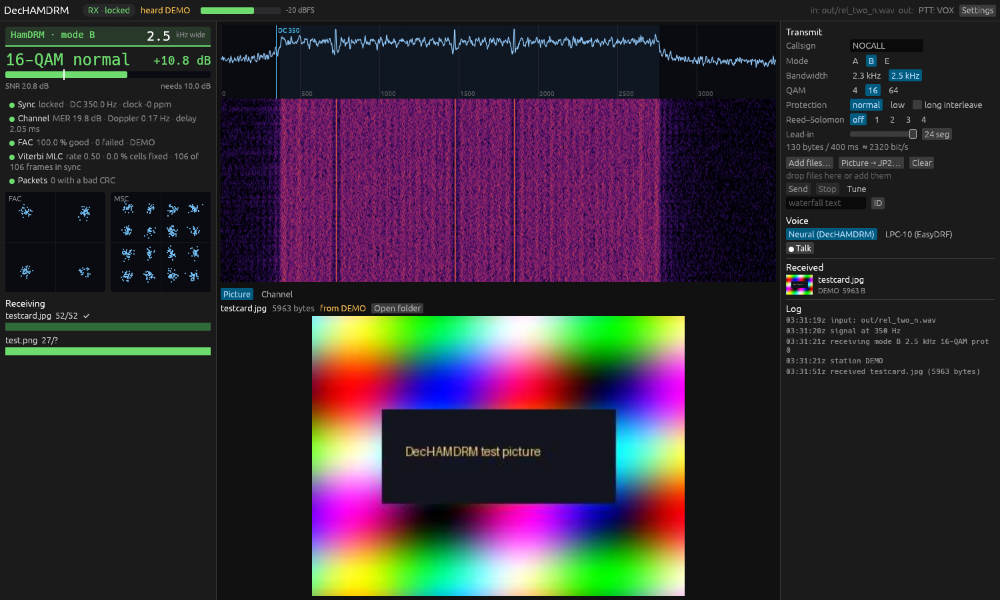
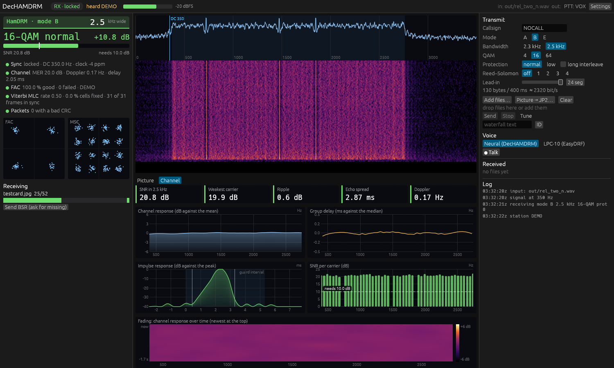
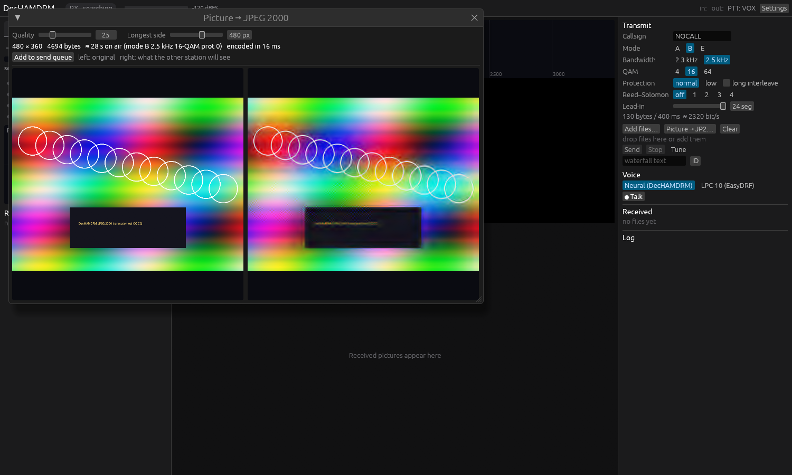
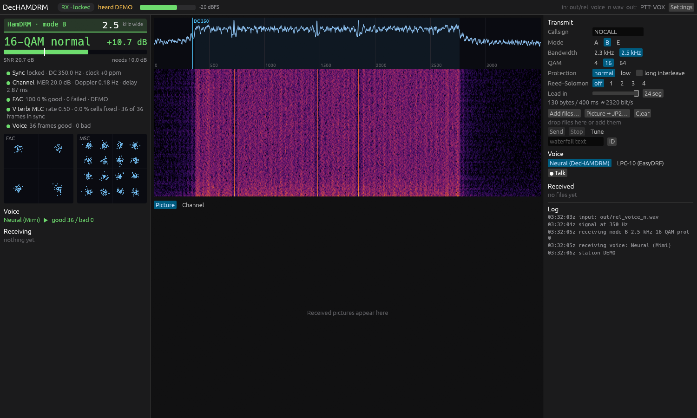

# DecHAMDRM

[](https://github.com/CasualArclamp/DecHAMDRM/releases/latest) [](https://github.com/CasualArclamp/DecHAMDRM/releases)

If you've found this worth your time, please consider [donating via PayPal](https://www.paypal.me/Arclamp).

**DecHAMDRM** is a HamDRM modem written in Rust: it sends and receives pictures, files
and digital voice over a 2.5 kHz SSB channel through the sound card, on-air compatible
with **EasyPal**, **EasyDRF** and **QSSTV**.



## What it does

**Pictures and files**
- HamDRM modes A, B and E, 2.3 and 2.5 kHz, 4/16/64-QAM, both protection levels, short
  and long interleaver.
- 4-QAM "low" is the HamDRM standard 4-QAM code; 4-QAM "normal" is DecHAMDRM's own
  more robust rate 1/2 (marked non-compliant: only DecHAMDRM receives it).
- Reed-Solomon file protection: EasyPal / QSSTV `.rs1`–`.rs4` (send and receive) and
  EasyDRF's own RS levels (receive).
- BSR: ask for the missing segments of a file, and answer other stations' requests.
- Progressive display: a JPEG 2000 or JPEG picture sent without Reed-Solomon shows
  while it arrives and sharpens as more comes in (the transcoder writes its files in
  quality layers for this).
- EasyPal / QSSTV hybrid mode (receive): when a station sends only a pointer to a
  picture on its FTP server, the pointer shows with a Fetch button; fetching without
  asking can be switched on in Settings.
- Picture → JPEG 2000 transcoder with a quality slider and a live preview of what the
  other station will see, with the file size and air time.

**Digital voice**
- EasyDRF-compatible LPC-10.
- A neural codec (Kyutai's Mimi, on the CPU) between DecHAMDRM stations: 4.4 to
  8.8 kbit/s depending on the mode. Its 385 MB of weights are downloaded on request
  (Settings, or `dechamdrm models download`).

**Receiver and display**
- Spectrum and waterfall at 2.9 Hz resolution, FAC and MSC constellations, and a
  receiver card with the link margin and the state of each stage.
- Channel tab: channel response, group delay, impulse response against the guard
  interval, SNR per carrier and a fading map.
- Waterfall text ID, tuning tone, PTT by CAT (IC-7300, FT-710, rigctld), DTR/RTS or VOX.

| | |
|---|---|
|  |  |
| Channel tab | Picture → JPEG 2000 transcoder |
|  | |
| Receiving neural digital voice | |

## Interoperability

Checked against EasyDRF built from source, in both directions (`docs/DESIGN.md`,
"Interop results"): all 30 mode / bandwidth / QAM / protection combinations byte-exact,
EasyDRF's Reed-Solomon levels, BSR requests and LPC-10 voice. Not yet checked against
EasyPal itself or QSSTV on the air, and EasyDRF's Speex voice mode is not supported.

## Download (Windows)

Portable executables for 64-bit Windows 10/11 are on the
[releases page](https://github.com/CasualArclamp/DecHAMDRM/releases/latest): nothing to
install.

- `dechamdrm-gui.exe` — the modem.
- `dechamdrm.exe` — command line: `tx` files to a WAV, `rx` a recording to files,
  `voice` a speech WAV to a transmission, `models` for the neural voice weights.

## Build on Linux

There is no Linux download; build it from source. The continuous integration builds and
tests every commit on Ubuntu, but the window itself has not been tried by hand on Linux.

1. Install Rust 1.95 or newer with [rustup](https://rustup.rs):

   ```bash
   curl --proto '=https' --tlsv1.2 -sSf https://sh.rustup.rs | sh
   ```

2. Install a C compiler and the development packages for the window, sound and serial
   ports. On Debian, Ubuntu or Raspberry Pi OS:

   ```bash
   sudo apt-get install -y build-essential pkg-config git libgl1-mesa-dev libxkbcommon-dev libxcb-render0-dev libxcb-shape0-dev libxcb-xfixes0-dev libx11-dev libasound2-dev libudev-dev
   ```

   On Fedora:

   ```bash
   sudo dnf install -y gcc gcc-c++ pkgconf-pkg-config git mesa-libGL-devel libxkbcommon-devel libxcb-devel libX11-devel alsa-lib-devel systemd-devel
   ```

3. Get the source and build:

   ```bash
   git clone https://github.com/CasualArclamp/DecHAMDRM.git
   ```

   ```bash
   cd DecHAMDRM && cargo build --release
   ```

4. Run it:

   ```bash
   ./target/release/dechamdrm-gui
   ```

Notes for Linux:

- Sound goes through ALSA (PipeWire and PulseAudio provide ALSA devices). Pick the
  radio's sound card for receive and transmit in Settings.
- For PTT over a serial port (CAT or DTR/RTS), your user needs access to it:
  `sudo usermod -aG dialout $USER`, then log out and in again.
- The neural voice weights (385 MB) are looked for in a `models` folder next to the
  program, in `./models`, or where `DECHAMDRM_MODELS` points. Fetch them with
  `./target/release/dechamdrm models download`. LPC-10 voice and pictures need none.

## Build on Windows

Rust (MSVC toolchain) and the Visual Studio Build Tools, then:

```bash
cargo build --release
```

`scripts/build-portable.ps1` builds the portable executables (static C runtime) into
`exe\`.

## Command line

```bash
dechamdrm tx picture.jpg --out tx.wav --mode B --bw wide --qam 16 --rs 2 --call MYCALL
```

```bash
dechamdrm rx recording.wav --out-dir received
```

```bash
dechamdrm voice speech.wav --out tx.wav --codec lpc10
```

WAV files are 48 kHz mono.

## Licence and credits

GPL-3.0-or-later. Built on [DecDRM](https://github.com/CasualArclamp/DecDRM) (the DRM30
receiver this descends from). The on-air formats come from
[EasyDRF](https://github.com/DazDSP/EasyDRF) by Daz Man (WinDRM / Dream lineage, GPL-3)
and [QSSTV](https://github.com/ON4QZ/QSSTV) (GPL-3). The LPC-10 codec is the HawkVoice
code as EasyDRF uses it (LGPL). The neural codec is Kyutai's Mimi (weights CC-BY-4.0),
run with [candle](https://github.com/huggingface/candle).

Design notes and test results: [`docs/DESIGN.md`](docs/DESIGN.md); format
specifications: [`docs/spec/`](docs/spec).
